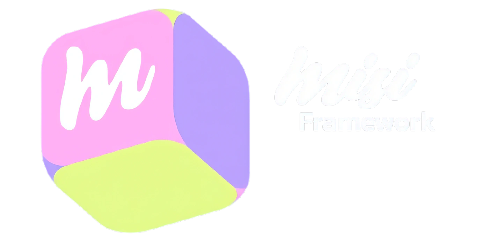

<div align="center">

<picture>
  <source media="(prefers-color-scheme: dark)" srcset="docs/readme_assets/misi-framework.svg">
  <source media="(prefers-color-scheme: light)" srcset="docs/readme_assets/misi-framework-dark.svg">
  
</picture>

<p align="center">

<strong>our own PHP development framework for quickly building administrative systems for small businesses; no over-engineering, no fluff.</strong>

</p>

<p align="center">
<a href="https://misi.freedev.app">Website</a> ·
<a href="#">Docs</a> ·
<a href="#">CLI</a>

</p>

<p align="center">
<em>Proprietary project for internal use. Not publicly distributed.</em>
</p>

---


</div>

<p align="justify">

MISI is not a general-purpose framework and does not compete with Laravel, Symfony, or similar professional tools. It is an internal PHP framework built to provide a complete technical foundation for developing administrative systems and commercial applications.

A new project starts directly from Misi. The framework already provides the common technical infrastructure required by an application, allowing development to focus on the functionality specific to the project.

> **Philosophy:** Provide the technical foundation once so every new application can start from an existing framework instead of rebuilding its underlying infrastructure from scratch.

Misi's success is not measured by how many features it has, but by a single question:

> **How much time do I save when starting and developing a new project?**

</p>

| | |
| ---- | ---- |
| **Technical framework**  | Configuration, routing, HTTP, database, authentication, authorization, validation, sessions, security, storage, logging, migrations, and error handling.                |
| **Application**          | The project-specific layer: controllers, services, repositories, models, views, routes, and custom business logic.                                                      |
| **Modules**              | Optional and isolated application features (`Modules\`) that can contain their own routes, controllers, services, repositories, models, views, and migrations.          |
| **CLI (`misi` / `biz`)** | Development commands for creating projects, managing the environment, running migrations and seeders, starting the local server, and generating application components. |
| **Security**             | Prepared statements, CSRF protection, HTTP security headers, authentication, authorization, validation, and explicit error handling.                                    |

---

## Using Misi

<table>
<tr>
<td width="50%" valign="top" align="justify">

<h3>Starting a new project</h3>

Create a new application directly from Misi and start with the framework's existing technical foundation already in place.

**[→ Go to Getting Started](#getting-started)**

</td>

<td width="50%" valign="top" align="justify">

<h3>Build and extend the application</h3>

Implement the functionality specific to the project and organize larger or isolated features as modules when appropriate.

**[→ Go to Modules](#modules)**

</td>
</tr>

<tr>

<td colspan="2" valign="top" align="justify">

<h3>Deploy the project on shared hosting</h3>

FTP + MySQL/MariaDB + PHP 8+. No Docker, no SSH, no persistent processes. Designed for traditional PHP hosting environments.

**[→ Go to Requirements and Deployment](#requirements-and-deployment)**

</td>
</tr>
</table>

---

## Getting Started

```bash
misi new <name>              # create a new project based on the framework

misi doctor                  # diagnose the current project's environment

misi db migrate              # run pending migrations

misi serve                   # start the development server

misi make controller <Name>  # generate a controller

misi make module <Name>      # scaffold a new module
```

<p align="justify">

Run <code>misi help</code> (or just <code>misi</code>) for the full command reference.

The CLI provides commands for project creation, environment diagnostics, database migrations, seeders, local development, and code generation. Depending on the installation method, the local project command is also available through <code>biz</code>.

</p>

---

## Application

<p align="justify">

Misi provides the reusable technical infrastructure, while each project contains its own application-specific functionality.

The application layer is where the project's actual requirements are implemented. It can contain:

* Controllers
* Services
* Repositories
* Models
* Views
* Routes
* Project-specific configuration
* Custom business rules

Misi does not require a project to inherit functionality from another previous application. Every new project starts with the framework itself and is then developed according to its own requirements.

</p>

---

### Modules

Namespace `Modules\`. A module can contain:

```text
Module/
├── Controllers/
├── Services/
├── Repositories/
├── Models/
├── Views/
├── routes.php
├── migrations/
└── module.php
```

<p align="justify">

Modules provide a way to organize isolated application functionality.

A module can contain its own:

* Controllers
* Services
* Repositories
* Models
* Views
* Routes
* Database migrations
* Module configuration

**Implemented:**

`Catalog` — a reference module that demonstrates the modular structure, including administrative functionality and protected routes.

Modules are part of the framework's architecture. A new project can use existing modules when they are included or create its own modules according to its requirements.

</p>

---

## Requirements and Deployment

<p align="justify">

Misi is designed for traditional PHP hosting, **without** requiring:

Docker / Kubernetes · Redis · Node.js in production · persistent workers · WebSockets · complex infrastructure.

**Target deployment:** PHP 8+ + MySQL/MariaDB.

Misi is intended to support conventional hosting environments where an application can be deployed using standard hosting tools.

**Typical deployment:** FTP + MySQL/MariaDB + PHP 8+.

The framework is designed to remain compatible with environments that do not provide SSH access, persistent processes, or containerized infrastructure.

</p>

---

## Why Misi Exists

<p align="justify">

Misi exists to provide a reusable technical foundation for developing applications without starting from zero every time.

When a new project is created, Misi already provides the common infrastructure required for application development:

</p>

```text
Configuration
HTTP handling
Routing
Database access
Migrations
Authentication
Authorization
Sessions
Validation
Security
Storage
Logging
Error handling
CLI tooling
Module support
```

<p align="justify">

This allows development to focus primarily on the functionality that makes each project different.

</p>

```text
Misi Framework
   ↓
Create a new project
   ↓
Configure the application
   ↓
Build project-specific functionality
   ↓
Add modules when needed
   ↓
Deploy
```

<p align="justify">

Misi is the reusable framework itself. A new project does not depend on previous projects in order to obtain its technical foundation.

Each project starts from Misi's existing infrastructure and is then extended according to its own requirements.

</p>

---

## Layered Architecture

```text
                    Misi
                      │
        ┌─────────────┴─────────────┐
        │                           │
    FRAMEWORK                  APPLICATION
 (namespace Misi\)       (project-specific logic)
        │                           │
        │                           │
        │                   Controllers, Services,
        │                   Repositories, Models,
        │                Views, Routes, Business Logic
        │                           │
        └─────────────┬─────────────┘
                      │
                    MODULES
              (namespace Modules\)
                      │
              ┌───────┼────────┐
              ↓       ↓        ↓
           Catalog   Custom   ...
                      │
                      ↓
              CUSTOMER APPLICATION
```

| Level | Responsibility |
| ---- | ----- |
| **1. Framework**| Reusable technical tools: configuration, routing, HTTP, database, authentication, authorization, validation, sessions, security, storage, logging, migrations, error handling, and CLI tooling. |
| **2. Application**| The project-specific implementation: controllers, services, repositories, models, views, routes, and custom business logic. |
| **3. Modules**| Isolated application functionality, such as `Catalog`, with its own internal structure and optional migrations. |
| **4. Application Delivery**| The final project configured and developed for its specific use case, including custom functionality, modules, visual customization, and project configuration. |

---

## Tools Used

    

---

## Roadmap and Frozen Features

<p align="justify">

Misi follows a deliberate approach to new framework features.

The goal is not to implement every possible abstraction in advance. New infrastructure should be added when it represents a real need for the framework.

Features that may remain intentionally postponed include:

* Additional routing abstractions
* Query Builder / ORM
* Additional framework-level services
* More specialized module types
* Advanced infrastructure features
* Integrations that are not required by the current architecture

This does not mean that these features are necessarily scheduled for immediate implementation. They remain postponed until there is a clear technical reason to add them.

Misi should grow as a framework without introducing unnecessary complexity.

</p>

---

## Project Work Principles

<p align="justify">

* **Phased approach:** Development should be performed in clear stages, validating each significant change before moving forward.

* **Audit before modifying:** New work begins by reviewing the existing code and architecture to understand the current implementation.

* **Cross-verification:** Changes should be validated using appropriate testing, functional HTTP checks, database verification, and PHP linting where applicable.

* **No abstraction without a real need:** Features should not be added only because they might be useful in the future.

* **Additive migrations:** Schema changes should be introduced through new migration files instead of editing migrations that have already been applied.

* **Verify before documenting:** Documentation should describe implemented and verified functionality.

* **Explicit failures:** Errors and invalid states should be handled clearly instead of being silently ignored.

</p>

---

## Directory Structure

```text
Misi/

├── .misi/                     # Technical core (namespace Misi\)
│   ├── Core/
│   ├── Database/
│   ├── Http/
│   ├── Routing/
│   ├── Auth/
│   ├── Security/
│   ├── Validation/
│   ├── Storage/
│   ├── Logging/
│   ├── Exceptions/
│   └── Support/
│
├── app/                       # Application-specific code (namespace App\)
│
├── modules/                   # Application modules (namespace Modules\)
│   └── Catalog/
│
├── bin/
│   ├── biz                    # Framework CLI (runs inside a project)
│   ├── misi                   # Global CLI wrapper (Linux/macOS)
│   └── build-landing.php      # Builds index.html + public/views/*.html from
│                              # public/views/_partials/ and _content/
├── misi.cmd                   # Windows CLI wrapper (batch)
├── misi.ps1                   # Windows CLI wrapper (PowerShell)
│
├── bootstrap/
├── config/
├── routes/
│
├── public/
│   ├── css/
│   ├── js/
│   └── views/                 # Generated marketing pages and their sources
│
├── resources/
│   ├── views/                 # PHP views rendered through the router
│   ├── scaffold/              # Template copied by "misi new"
│   └── stubs/                 # Templates used by the make:* generators
│
├── storage/
│   ├── logs/
│   ├── cache/
│   └── uploads/
│
├── database/
│   ├── migrations/
│   └── seeders/
│
├── docs/
│
├── index.html                 # Framework marketing landing page
├── install.sh                 # Global installer
├── .env.example
├── .gitignore
└── README.md
```

<p align="justify">

This tree describes **this repository** — the framework's own source code, CLI tools, documentation, scaffolding resources, modules, and marketing site.

A project created with <code>misi new</code> receives the structure required to develop an application on top of Misi's technical foundation.

The generated project is focused on the application itself: configuration, routes, project-specific functionality, modules, database files, templates, public assets, and the framework infrastructure required at runtime.

</p>

---

## Author

**Emily Monterrosa Castro - Full Stack Developer** <br>
[GitHub](https://github.com/emilymontec) · [LinkedIn](https://www.linkedin.com/in/emilymontec/) · [Portfolio](https://emilymontec.github.io/portfolio/)

---

## License

Proprietary project for internal use. Not publicly distributed.

---

## Appendices

If you want to know more about the system, please check the [Documentation](docs/DOCUMENTACION%20TECNICA%20MISI%20FRAMEWORK.pdf).
